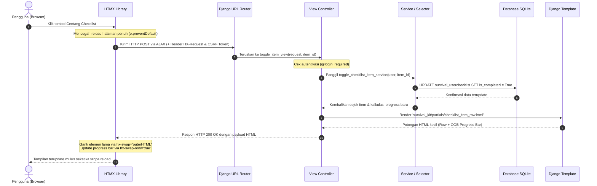

# 📖 DOKUMENTASI TEKNIS & PANDUAN BELAJAR RANTAUHUB
> **Pedoman Pembelajaran Lengkap & Terstruktur Pemrograman Web Berbasis Python Django, HTMX, dan Tailwind CSS**  
> *Dibuat khusus sebagai mentor belajar mandiri: Dari nol hingga mahir memahami setiap baris kode, arsitektur, dan logika aplikasi.*

---

## 🧭 KATA PENGANTAR DARI MENTOR

Halo pejuang kode! Selamat datang di modul pembelajaran **RantauHub**.

Membaca dan memahami kode proyek yang sudah berjalan untuk pertama kalinya (*codebase exploration*) bisa terasa membingungkan atau bahkan menakutkan bagi pemula. Mungkin kamu bertanya-tanya:
- *"Kenapa file-nya begitu banyak?"*
- *"Apa maksud kata `import`, `class`, `def`, atau simbol `@` di atas fungsi?"*
- *"Bagaimana data dari formulir di browser bisa tersimpan rapi ke dalam database?"*
- *"Bagaimana tombol checklist bisa mencentang sendiri tanpa membuat halaman website berkedip (reload)?"*

Tarik napas dalam-dalam. Dokumen ini ditulis dengan pendekatan **mentor yang sabar**. Kita tidak akan melompati konsep-konsep penting. Setiap struktur folder, sintaks dasar, blok kode rumit, hingga alur kerja website dari hulu ke hilir akan dibedah dengan bahasa yang ramah, analogi kehidupan sehari-hari, dan contoh nyata.

Siapkan minuman hangat favoritmu, mari kita bedah kode RantauHub bersama-sama!

---

## 📑 DAFTAR ISI

1. [BAB 1: Anatomi Struktur Folder dan File](#bab-1-anatomi-struktur-folder-dan-file)
   - [1.1 Peta Hirarki Folder Proyek](#11-peta-hirarki-folder-proyek)
   - [1.2 Penjelasan Peran Setiap File dan Folder](#12-penjelasan-peran-setiap-file-dan-folder)
   - [1.3 Mengapa Menggunakan Arsitektur Modular (*Separation of Concerns*)?](#13-mengapa-menggunakan-arsitektur-modular-separation-of-concerns)
2. [BAB 2: Kamus Konsep Dasar & Sintaks Pemrograman](#bab-2-kamus-konsep-dasar--sintaks-pemrograman)
   - [2.1 Sintaks Fondasi Python](#21-sintaks-fondasi-python)
   - [2.2 Konsep Kunci Django Framework](#22-konsep-kunci-django-framework)
   - [2.3 Konsep Antarmuka Frontend (Tailwind CSS, HTMX, Alpine.js)](#23-konsep-antarmuka-frontend-tailwind-css-htmx-alpinejs)
3. [BAB 3: Bedah Kode Baris per Baris (Line-by-Line Breakdown)](#bab-3-bedah-kode-baris-per-baris-line-by-line-breakdown)
   - [3.1 `manage.py` — Gerbang Utama CLI](#31-managepy--gerbang-utama-cli)
   - [3.2 `config/settings/base.py` — Jantung Konfigurasi Aplikasi](#32-configsettingsbasepy--jantung-konfigurasi-aplikasi)
   - [3.3 `config/urls.py` — Resepsionis & Papan Rute Utama](#33-configurlspy--resepsionis--papan-rute-utama)
   - [3.4 `apps/users/models/user.py` — Model Pengguna Kustom](#34-appsusersmodelsuserpy--model-pengguna-kustom)
   - [3.5 `apps/survival_kit/models/checklist.py` — Struktur Relasi Database Checklist](#35-appssurvival_kitmodelschecklistpy--struktur-relasi-database-checklist)
   - [3.6 `apps/survival_kit/views/checklist.py` — Pengendali (View Controller) Checklist](#36-appssurvival_kitviewschecklistpy--pengendali-view-controller-checklist)
   - [3.7 `apps/survival_kit/services/budget_calculator.py` — Mesin Hitung Anggaran](#37-appssurvival_kitservicesbudget_calculatorpy--mesin-hitung-anggaran)
   - [3.8 `apps/emergency/services/wa_encoder.py` — Generator Pesan WhatsApp Darurat](#38-appsemergencyserviceswa_encoderpy--generator-pesan-whatsapp-darurat)
   - [3.9 `templates/survival_kit/partials/checklist_item_row.html` — Template Reaktif HTMX](#39-templatessurvival_kitpartialschecklist_item_rowhtml--template-reaktif-htmx)
4. [BAB 4: Penjelasan Logika Kompleks & Arsitektur Lanjutan](#bab-4-penjelasan-logika-kompleks--arsitektur-lanjutan)
   - [4.1 Pengelolaan Database & Relasi ORM (Object-Relational Mapping)](#41-pengelolaan-database--relasi-orm-object-relational-mapping)
   - [4.2 Siklus Request, Dispatching URL, dan Response](#42-siklus-request-dispatching-url-dan-response)
   - [4.3 State Management, Sesi Login, dan Keamanan Data Isolation (Anti-IDOR)](#43-state-management-sesi-login-dan-keamanan-data-isolation-anti-idor)
   - [4.4 Arsitektur Server-Driven UI via HTMX & Out-of-Band (OOB) Swap](#44-arsitektur-server-driven-ui-via-htmx--out-of-band-oob-swap)
   - [4.5 Algoritma Presisi Finansial (`Decimal` vs `Float`)](#45-algoritma-presisi-finansial-decimal-vs-float)
   - [4.6 Algoritma Normalisasi Telepon & URL Encoding RFC 3986](#46-algoritma-normalisasi-telepon--url-encoding-rfc-3986)
5. [BAB 5: Alur Kerja Keseluruhan (End-to-End System Flow)](#bab-5-alur-kerja-keseluruhan-end-to-end-system-flow)
   - [5.1 Diagram Siklus Permintaan HTTP Django](#51-diagram-siklus-permintaan-http-django)
   - [5.2 Alur Pengalaman Pengguna Lengkap (User Journey)](#52-alur-pengalaman-pengguna-lengkap-user-journey)
6. [BAB 6: Pesan Mentor & Saran Pengembangan Lanjutan](#bab-6-pesan-mentor--saran-pengembangan-lanjutan)

---

## BAB 1: ANATOMI STRUKTUR FOLDER DAN FILE

Sebelum mulai menulis baris kode, seorang arsitek perangkat lunak yang baik akan merancang struktur rumahnya terlebih dahulu. Proyek **RantauHub** menggunakan struktur modular modern Django yang rapi dan terukur.

### 1.1 Peta Hirarki Folder Proyek

```text
D:\RantauHub
├── .env                          # Variabel rahasia lokal (tidak di-commit ke Git)
├── .env.example                  # Contoh template variabel lingkungan
├── .gitignore                    # Daftar file yang diabaikan oleh Git
├── db.sqlite3                    # Berkas database relasional lokal SQLite
├── manage.py                     # Skrip manajemen perintah CLI Django
├── requirements.txt              # Daftar pustaka (dependencies) Python pihak ketiga
├── README.md                     # Ringkasan informasi proyek dan cara instalasi
├── IMPLEMENTATION_PLAN.md        # Rencana arsitektur dan tahapan implementasi
├── PANDUAN_PRESENTASI.md         # Naskah presentasi, slide guide, & kunci jawaban sidang
├── DOKUMENTASI.md                # File panduan belajar komprehensif ini
│
├── config/                       # Konfigurasi Pusat Proyek Django
│   ├── __init__.py               # Penanda bahwa folder ini adalah package Python
│   ├── asgi.py                   # Antarmuka server asynchronous (ASGI)
│   ├── wsgi.py                   # Antarmuka server synchronous standar (WSGI)
│   ├── urls.py                   # Induk seluruh rute (Master URL Routing)
│   └── settings/                 # Konfigurasi aplikasi modular
│       ├── __init__.py           # Mengarahkan setting default ke base.py
│       ├── base.py               # Pengaturan utama: Database, Apps, Middleware
│       ├── development.py        # Pengaturan khusus server lokal
│       └── production.py         # Pengaturan server live/produksi
│
├── apps/                         # Seluruh Modul Fungsional Aplikasi
│   ├── common/                   # Fitur bersama: Base Model, Halaman Statis, Error Pages
│   │   ├── models.py             # TimeStampedModel (created_at, updated_at)
│   │   ├── views.py              # home_view, about_view, 404/500 handler
│   │   └── templatetags/         # Filter & tag kustom untuk Django Template
│   │
│   ├── users/                    # Modul Autentikasi & Akun Anak Rantau
│   │   ├── models/user.py        # Custom User Model (kota asal, kota tujuan, kontak darurat)
│   │   ├── views/auth.py         # Register, Login, Logout views
│   │   ├── views/profile.py      # Profil & Dashboard view
│   │   ├── forms/                # Form validasi data registrasi & profil
│   │   └── urls.py               # Rute /auth/register/, /auth/login/, dll.
│   │
│   ├── survival_kit/             # Modul Survival Kit: Checklist & Simulasi Anggaran
│   │   ├── models/checklist.py   # Skema checklist template & progress pengguna
│   │   ├── models/budget.py      # Skema penyimpanan rencana simulasi anggaran
│   │   ├── models/guide.py       # Artikel panduan adaptasi anak rantau
│   │   ├── services/             # Logika bisnis murni (budget_calculator, checklist_service)
│   │   ├── views/                # Views checklist, kalkulator anggaran, panduan
│   │   └── urls.py               # Rute /survival/checklist/, /survival/budget/, dll.
│   │
│   ├── directory/                # Modul Direktori Layanan Esensial
│   │   ├── models/place.py       # Data fasilitas (Puskesmas, Apotek, Warteg, Laundry)
│   │   ├── models/favorite.py    # Sistem bookmark tempat favorit
│   │   ├── selectors/            # Logika query pencarian & filter multi-parameter
│   │   ├── views/                # List view, Detail view, Bookmark toggle
│   │   └── urls.py               # Rute /directory/
│   │
│   ├── emergency/                # Modul Pusat Darurat & Hotline SOS
│   │   ├── services/wa_encoder.py # Pembuat tautan pesan otomatis WhatsApp
│   │   ├── views/card.py         # SOS Card mobile-first
│   │   ├── views/whatsapp_generator.py # Form generator pesan darurat
│   │   ├── views/bpjs_guide.py   # Panduan pindah faskes BPJS & berkas hilang
│   │   └── urls.py               # Rute /emergency/card/, /emergency/whatsapp/, dll.
│   │
│   └── community/                # Modul Forum Diskusi & Moderasi Komunitas
│       ├── models/thread.py      # Skema pertanyaan diskusi rantau
│       ├── models/reply.py       # Skema tanggapan jawaban & lencana Accepted Answer
│       ├── models/report.py      # Skema pelaporan konten melanggar
│       ├── views/                # List thread, buat diskusi, beri tanggapan, lapor
│       └── urls.py               # Rute /community/
│
├── templates/                    # Berkas Template Antarmuka Pengguna (HTML)
│   ├── base.html                 # Rangka utama website (Header, CDN Tailwind, HTMX, Footer)
│   ├── components/               # Komponen UI modular (navbar.html, footer.html, alert.html)
│   ├── pages/                    # Halaman umum (home.html, dashboard.html, 404.html)
│   ├── users/                    # Template register.html, login.html, profile.html
│   ├── survival_kit/             # Template checklist_list.html, budget_calculator.html
│   │   └── partials/             # Potongan HTML kecil untuk respon HTMX tanpa reload
│   ├── directory/                # Template place_list.html, place_detail.html
│   ├── emergency/                # Template emergency_card.html, whatsapp_generator.html
│   └── community/                # Template thread_list.html, thread_detail.html
│
├── static/                       # Aset Statis Sisi Klien
│   ├── css/style.css             # Penyesuaian CSS kustom
│   ├── js/main.js                # Skrip pendukung sisi browser
│   └── images/                   # Favicon, logo, dan ilustrasi
│
└── tests/                        # Berkas Pengujian Otomatis (Automated Unit Tests)
    ├── test_auth.py              # Pengujian register, login, & isolasi akun
    ├── test_survival_kit.py      # Pengujian rumus kalkulator anggaran & checklist
    ├── test_directory.py         # Pengujian search selector & filter kota
    ├── test_emergency.py         # Pengujian URL encoding pesan WhatsApp
    └── test_community.py         # Pengujian posting thread & accepted answer
```

---

### 1.2 Penjelasan Peran Setiap File dan Folder

Mari kita telaah alasan mengapa setiap file diletakkan di posisinya masing-masing:

#### A. Berkas-Berkas di Tingkat Root (Akar Proyek)
1. **`manage.py`**
   - **Peran:** Perangkat kendali baris perintah (*CLI - Command Line Interface*) bawaan Django.
   - **Mengapa ada di sana?** Django membutuhkan satu file eksekutabel utama di akar proyek untuk menjalankan perintah seperti `runserver` (menjalankan website), `makemigrations` (mendeteksi perubahan skema tabel), dan `migrate` (menerapkan tabel ke database).
2. **`.env` dan `.env.example`**
   - **Peran:** Menyimpan rahasia aplikasi seperti `SECRET_KEY` dan status `DEBUG`.
   - **Mengapa ada di sana?** Menurut kaidah standar industri (*The Twelve-Factor App*), kode program tidak boleh memuat password atau kunci rahasia secara langsung (*hardcoded*). File `.env` disimpan secara privat di komputer pengembang lokal, sementara `.env.example` dibagikan sebagai panduan tanpa membocorkan nilai rahasia aslinya.
3. **`requirements.txt`**
   - **Peran:** Mencatat daftar paket Python pihak ketiga yang dibutuhkan proyek beserta nomor versinya (seperti `django>=5.0`, `python-decouple`, dan `pillow`).
   - **Mengapa ada di sana?** Agar siapa pun yang mengunduh proyek ini dapat langsung menginstal semua dependensi yang cocok hanya dengan mengetik satu perintah: `pip install -r requirements.txt`.
4. **`db.sqlite3`**
   - **Peran:** Berkas database relasional bawaan SQLite yang menyimpan seluruh data pengguna, checklist, tempat penting, dan thread diskusi.
   - **Mengapa ada di sana?** SQLite menyimpan seluruh database dalam satu file lokal tunggal, sehingga kamu tidak perlu menginstal server database berat seperti MySQL atau PostgreSQL saat fase belajar dan pengujian di komputer pribadi.

---

#### B. Folder `config/` (Pusat Kendali Proyek)
- **`config/settings/base.py`:** Berisi seluruh konfigurasi global: daftar aplikasi yang terpasang (`INSTALLED_APPS`), lapisan keamanan (`MIDDLEWARE`), lokasi folder template (`TEMPLATES`), koneksi database (`DATABASES`), dan pengaturan zona waktu (`TIME_ZONE = 'Asia/Jakarta'`).
- **`config/urls.py`:** Papan penunjuk rute utama. Setiap kali browser meminta alamat web (misalnya `http://localhost:8000/survival/checklist/`), file inilah yang pertama kali menyambut permintaan tersebut dan meneruskannya ke modul yang tepat.
- **`config/wsgi.py` & `asgi.py`:** Jembatan standar (*Web Server Gateway Interface*) yang digunakan ketika website di-deploy ke server produksi sungguhan di internet (seperti Nginx atau Gunicorn).

---

#### C. Folder `apps/` (Kumpulan Aplikasi Fungsional)
Django menganut konsep **Aplikasi Pluggable**. Sebuah proyek besar dipecah menjadi beberapa aplikasi kecil independen (`apps`) yang masing-masing bertanggung jawab atas satu domain bisnis:
1. **`apps/common`:** Berisi cetak biru bersama yang bisa dipakai oleh aplikasi lain (seperti `TimeStampedModel` untuk mencatat tanggal pembuatan data secara otomatis) serta halaman statis (Beranda, Tentang Kami, dan halaman error 404).
2. **`apps/users`:** Mengelola siklus hidup akun pengguna, registrasi, formulir login berbasis session, dan profil perantau (kota asal, kota rantau tujuan, kontak darurat).
3. **`apps/survival_kit`:** Mengelola sistem checklist persiapan berangkat dan mesin kalkulasi anggaran bulanan 30 hari.
4. **`apps/directory`:** Mengelola pangkalan data layanan esensial (puskesmas, klinik 24 jam, warteg murah, laundry) lengkap dengan filter kota dan status verifikasi.
5. **`apps/emergency`:** Mengelola fitur darurat: Kartu SOS digital, nomor telepon darurat Indonesia (110, 119, 113, dll.), dan generator pesan WhatsApp siap kirim.
6. **`apps/community`:** Mengelola forum tanya-jawab antar-perantau, sistem jawaban terbaik (*Accepted Answer*), dan pelaporan moderasi konten.

---

### 1.3 Mengapa Menggunakan Arsitektur Modular (*Separation of Concerns*)?

Pada tutorial Django pemula di internet, sering kali kita melihat seluruh model ditaruh di `models.py` (satu file raksasa ratusan baris) dan seluruh fungsi ditaruh di `views.py`. 

Pada proyek **RantauHub**, kita menerapkan standar industri:
1. **Aturan 150 Baris (*The 150-Line Threshold*):** Tidak ada satu pun file Python yang terlalu panjang dan membingungkan. Folder `models/`, `views/`, `services/`, dan `selectors/` dipecah menjadi file-file kecil yang terfokus.
2. **Pemisahan Lapisan Tanggung Jawab (*Layered Architecture*):**
   - **`models/` (Data Layer):** Hanya mendefinisikan bentuk tabel dan kolom di database.
   - **`views/` (Transport Layer):** Bertindak sebagai "pelayan restoran" yang menerima pesanan dari browser, memvalidasi form, lalu mengembalikan piring HTML.
   - **`services/` (Business Logic Layer):** Bertindak sebagai "koki di dapur" yang melakukan perhitungan matematika rumit (seperti kalkulator anggaran di `budget_calculator.py`).
   - **`selectors/` (Query Layer):** Bertindak sebagai "petugas gudang" yang bertugas menyaring dan mengambil data dari database dengan cepat (seperti pencarian fasilitas di `place_search.py`).

Keuntungannya? Kode menjadi **sangat mudah dipahami**, mudah diperbaiki saat terjadi kesalahan (*bug*), dan mudah diuji secara otomatis (*unit testing*).

---

## BAB 2: KAMUS KONSEP DASAR & SINTAKS PEMROGRAMAN

Bagi pemula, membaca kode sering kali terhambat karena tidak tahu arti dari kata-kata kunci tertentu. Mari kita bedah konsep dasar yang paling sering muncul di proyek RantauHub.

### 2.1 Sintaks Fondasi Python

#### A. Perintah `import` dan `from ... import ...`
- **Apa artinya?** Perintah ini digunakan untuk meminjam atau mengambil alat/fitur dari file atau pustaka lain.
- **Analogi:** Bayangkan kamu sedang merakit lemari di kamarmu. Kamu tidak membuat obeng dari bijih besi sendiri, melainkan meminjam obeng dari kotak perkakas di garasi.
- **Contoh di kode:**
  ```python
  # Mengambil seluruh modul 'os' untuk membaca sistem operasi
  import os

  # Hanya mengambil fungsi 'render' dan 'redirect' dari modul django.shortcuts
  from django.shortcuts import render, redirect
  ```

#### B. Perintah `def` (Mendefinisikan Fungsi)
- **Apa artinya?** `def` adalah singkatan dari *define*. Perintah ini digunakan untuk membuat sekumpulan instruksi kerja yang memiliki nama dan dapat dipanggil berulang kali.
- **Contoh di kode:**
  ```python
  def sapa_perantau(nama_kota):
      pesan = f"Selamat datang di kota {nama_kota}!"
      return pesan
  ```
  - `nama_kota`: Disebut **parameter** (wadah penampung input).
  - `return`: Kata kunci untuk mengembalikan hasil kerja fungsi kembali ke si pemanggil.

#### C. Perintah `class` dan Konsep Pewarisan (*Inheritance*)
- **Apa artinya?** `class` adalah cetak biru (*blueprint*) untuk membuat sebuah objek. Pewarisan (*inheritance*) adalah kemampuan sebuah class anak untuk menyerap semua sifat dan kemampuan dari class induknya.
- **Analogi:** Cetak biru mobil. Jika kamu membuat class `MobilBalap` yang mewarisi class `Mobil`, maka `MobilBalap` otomatis sudah memiliki roda, kemudi, dan mesin tanpa perlu ditulis ulang dari nol. Kamu tinggal menambahkan atribut baru seperti `turbo_speed`.
- **Contoh di kode:**
  ```python
  from django.contrib.auth.models import AbstractUser

  # Class User kita adalah anak yang mewarisi seluruh kemampuan AbstractUser milik Django
  class User(AbstractUser):
      origin_city = models.CharField(max_length=100) # Atribut tambahan khusus RantauHub
  ```

#### D. Sintaks `@decorator` (Simbol `@` di Atas Fungsi)
- **Apa artinya?** Decorator adalah pembungkus fungsi yang bertugas memeriksa atau memodifikasi perilaku fungsi di bawahnya sebelum dijalankan.
- **Analogi:** Paspampres atau satpam pemeriksa tiket di pintu masuk gedung konser. Sebelum kamu boleh masuk menikmati konser (menjalankan fungsi view), satpam memeriksa apakah kamu punya tiket resmi atau belum.
- **Contoh di kode:**
  ```python
  from django.contrib.auth.decorators import login_required

  @login_required # Satpam: Jika pengguna belum login, otomatis dilempar ke halaman login!
  def dashboard_view(request):
      return render(request, 'pages/dashboard.html')
  ```

#### E. Sintaks `@property`
- **Apa artinya?** Mengubah sebuah method/fungsi di dalam class agar bisa dipanggil layaknya atribut variabel biasa (tanpa tanda kurung buka-tutup `()`).
- **Contoh di kode:**
  ```python
  class User(AbstractUser):
      origin_city = models.CharField(max_length=100)
      target_city = models.CharField(max_length=100)

      @property
      def has_completed_profile(self):
          # Kita bisa memanggil: user.has_completed_profile (bukan user.has_completed_profile())
          return bool(self.origin_city and self.target_city)
  ```

#### F. Tipe Data `Decimal` vs `float`
- **Apa artinya?** Di Python, `float` (bilangan desimal biner biasa) memiliki cacat ketepatan mikroskopis di memori komputer (misalnya `0.1 + 0.2` menghasilkan `0.30000000000000004`). Dalam aplikasi keuangan dan anggaran seperti RantauHub, hal ini berbahaya karena rupiah bisa hilang atau bertambah satu sen secara gaib.
- **Solusi:** Modul `from decimal import Decimal` digunakan untuk perhitungan mata uang dengan ketelitian mutlak.

---

### 2.2 Konsep Kunci Django Framework

#### A. Arsitektur MTV (Model - Template - View)
Django membagi cara kerja website menjadi 3 komponen utama:
1. **Model:** Ahli data. Berinteraksi dengan database untuk membuat tabel, menyimpan, atau mengambil data.
2. **Template:** Ahli tampilan visual. Berupa file HTML yang disisipi penanda khusus untuk menampilkan data dinamis ke layar browser.
3. **View:** Otak pengendali. Menerima input dari pengguna (klik atau ketikan), meminta data ke Model, lalu memilih Template mana yang harus dirender dan dikirim ke browser.

#### B. Django ORM (*Object-Relational Mapping*)
Di masa lalu, pemrogram harus mengetik perintah SQL mentah yang rumit dan rentan dibobol peretas (*SQL Injection*), seperti:
```sql
SELECT * FROM users_user WHERE target_city = 'Yogyakarta';
```
Dengan Django ORM, kamu cukup menulis perintah Python yang sangat bersih dan aman:
```python
User.objects.filter(target_city='Yogyakarta')
```
Django akan menerjemahkan baris Python tersebut menjadi perintah SQL otomatis di balik layar!

#### C. Django Template Language (DTL)
Di dalam file HTML, kita dapat menampilkan data dinamis dari Python menggunakan tag-tag khusus:
- `{{ variable }}`: Mencetak isi variabel (contoh: `{{ user.username }}` akan mencetak nama pengguna).
- ` ... `: Logika percabangan tampilan kondisi.
- ` ... `: Perulangan daftar elemen.
- ``: Menghasilkan link URL secara otomatis dan dinamis tanpa harus mengetik alamat path secara manual.

---

### 2.3 Konsep Antarmuka Frontend (Tailwind CSS, HTMX, Alpine.js)

RantauHub menggunakan arsitektur **Server-Driven Modern UI**:
1. **Tailwind CSS:** Framework styling berbasis kelas utilitas. Kita tidak perlu menulis file CSS terpisah yang panjang. Cukup tempelkan kelas seperti `bg-blue-600` (warna latar biru), `p-4` (padding 1rem), dan `rounded-lg` (sudut membulat) langsung pada tag HTML.
2. **HTMX:** Senjata rahasia RantauHub! HTMX memungkinkan elemen HTML biasa (seperti tombol `<button>` atau dropdown `<select>`) melakukan permintaan ke server (AJAX) di latar belakang dan memperbarui sebagian isi halaman tanpa membuat seluruh browser me-refresh halaman (*No Full Page Reload*).
3. **Alpine.js:** Pustaka JavaScript sangat ringan yang digunakan untuk interaksi mikro di sisi browser (seperti membuka/menutup menu navigasi hamburger di ponsel pintar).

---

## BAB 3: BEDAH KODE BARIS PER BARIS (LINE-BY-LINE BREAKDOWN)

Sekarang kita masuk ke bagian yang paling seru! Kita akan mengambil potongan kode asli dari file-file terpenting di RantauHub dan membedah apa yang terjadi di setiap barisnya.

---

### 3.1 `manage.py` — Gerbang Utama CLI

File ini adalah file pertama yang kamu sentuh saat mengetik perintah `python manage.py runserver`.

```python
1:  #!/usr/bin/env python
2:  """Django's command-line utility for administrative tasks."""
3:  import os
4:  import sys
5:  
6:  def main():
7:      """Run administrative tasks."""
8:      os.environ.setdefault('DJANGO_SETTINGS_MODULE', 'config.settings')
9:      try:
10:         from django.core.management import execute_from_command_line
11:     except ImportError as exc:
12:         raise ImportError(
13:             "Couldn't import Django. Are you sure it's installed and "
14:             "available on your PYTHONPATH environment variable? Did you "
15:             "forget to activate a virtual environment?"
16:         ) from exc
17:     execute_from_command_line(sys.argv)
18: 
19: if __name__ == '__main__':
20:     main()
```

#### 🔍 Penjelasan Baris demi Baris:
- **Baris 1:** `#!/usr/bin/env python` — Disebut *Shebang line*. Memberitahu sistem operasi Linux/macOS interpreter mana yang harus digunakan untuk mengeksekusi file ini.
- **Baris 3–4:** `import os` dan `import sys` — Mengambil pustaka bawaan Python untuk mengelola variabel sistem operasi (`os`) dan argumen baris perintah (`sys`).
- **Baris 6:** `def main():` — Titik masuk utama (*entry point*) fungsi eksekusi program.
- **Baris 8:** `os.environ.setdefault('DJANGO_SETTINGS_MODULE', 'config.settings')` — Memberitahu Django di mana letak file konfigurasinya. Di sini, kita mengarahkan Django ke folder `config.settings`.
- **Baris 9–10:** `try:` dan `from django.core.management import execute_from_command_line` — Mencoba memuat fungsi inti pengeksekusi perintah Django.
- **Baris 11–16:** `except ImportError as exc:` — Jika Django belum terinstal di komputer (atau kamu lupa mengaktifkan *virtual environment*), blok ini akan menangkap error tersebut dan menampilkan pesan panduan yang ramah alih-alih melempar pesan error yang menakutkan.
- **Baris 17:** `execute_from_command_line(sys.argv)` — Membaca argumen yang kamu ketik di terminal (misalnya kata `runserver` atau `migrate`) lalu menjalankannya.
- **Baris 19–20:** `if __name__ == '__main__': main()` — Baris standar Python yang berarti: *"Jika file ini dijalankan langsung oleh pengguna di terminal (bukan di-import oleh file lain), maka jalankan fungsi `main()`."*

---

### 3.2 `config/settings/base.py` — Jantung Konfigurasi Aplikasi

File ini menentukan perilaku seluruh sistem RantauHub.

```python
1:  import os
2:  from pathlib import Path
3:  from decouple import config, Csv
4:  
5:  BASE_DIR = Path(__file__).resolve().parent.parent.parent
6:  
7:  SECRET_KEY = config('SECRET_KEY', default='django-insecure-rantauhub-default-key-392842')
8:  DEBUG = config('DEBUG', default=True, cast=bool)
9:  ALLOWED_HOSTS = config('ALLOWED_HOSTS', default='*', cast=Csv())
```

#### 🔍 Penjelasan Baris demi Baris:
- **Baris 2:** `from pathlib import Path` — Alat modern Python untuk mengelola jalur alamat folder (*file path*).
- **Baris 3:** `from decouple import config, Csv` — Meminjam fungsi dari pustaka `python-decouple` untuk membaca variabel dari file `.env` secara aman.
- **Baris 5:** `BASE_DIR = Path(__file__).resolve().parent.parent.parent` — Mencari tahu letak absolut folder akar `D:\RantauHub`. Tiga kali pemanggilan `.parent` naik tiga tingkat dari folder `config/settings/` menuju ke akar proyek.
- **Baris 7:** `SECRET_KEY = config(...)` — Kunci enkripsi kriptografi untuk melindungi password dan data sesi pengguna. Jika tidak ada di file `.env`, gunakan nilai bawaan (*fallback*).
- **Baris 8:** `DEBUG = config('DEBUG', default=True, cast=bool)` — Menentukan apakah mode perbaikan aktif. Jika `True`, Django akan menampilkan halaman error yang detail saat terjadi kesalahan penulisan kode.
- **Baris 9:** `ALLOWED_HOSTS = config('ALLOWED_HOSTS', default='*', cast=Csv())` — Daftar nama domain yang diizinkan mengakses website ini. Tanda `*` berarti menerima akses dari alamat mana pun (cocok untuk pengujian lokal).

Mari kita lihat bagian penting lainnya di file ini:
```python
65: AUTH_USER_MODEL = 'users.User'
74: LANGUAGE_CODE = 'id-id'
75: TIME_ZONE = 'Asia/Jakarta'
88: LOGIN_URL = 'users:login'
89: LOGIN_REDIRECT_URL = 'dashboard'
```
- **Baris 65:** `AUTH_USER_MODEL = 'users.User'` — Menginstruksikan Django untuk mengganti model User standar dengan Custom User Model buatan kita di aplikasi `users`.
- **Baris 74–75:** Mengatur bahasa antarmuka bawaan ke Bahasa Indonesia dan zona waktu ke Waktu Indonesia Barat (`Asia/Jakarta`).
- **Baris 88–89:** Jika pengguna yang belum login mencoba membuka halaman privat, mereka akan otomatis diarahkan ke halaman login (`users:login`), dan setelah berhasil login langsung diarahkan ke halaman `dashboard`.

---

### 3.3 `config/urls.py` — Resepsionis & Papan Rute Utama

File ini menerima URL dari browser dan membagikan tugas ke rute masing-masing aplikasi:

```python
1:  from django.contrib import admin
2:  from django.urls import path, include
3:  from apps.common.views import home_view, about_view
4:  from apps.users.views import dashboard_view
5:  
6:  urlpatterns = [
7:      path('admin/', admin.site.urls),
8:      path('', home_view, name='home'),
9:      path('about/', about_view, name='about'),
10:     path('dashboard/', dashboard_view, name='dashboard'),
11:     
12:     # App Modular Routes
13:     path('auth/', include('apps.users.urls', namespace='users')),
14:     path('survival/', include('apps.survival_kit.urls', namespace='survival_kit')),
15:     path('directory/', include('apps.directory.urls', namespace='directory')),
16:     path('emergency/', include('apps.emergency.urls', namespace='emergency')),
17:     path('community/', include('apps.community.urls', namespace='community')),
18: ]
```

#### 🔍 Penjelasan Baris demi Baris:
- **Baris 2:** `from django.urls import path, include` — `path` digunakan untuk memetakan satu rute URL ke satu fungsi view. `include` digunakan untuk meneruskan sekelompok rute ke file `urls.py` milik modul lain.
- **Baris 7:** `path('admin/', admin.site.urls)` — Membuka antarmuka panel administrasi bawaan Django di URL `/admin/`.
- **Baris 8:** `path('', home_view, name='home')` — Jika pengguna membuka halaman utama tanpa tambahan path (akar website), jalankan fungsi `home_view`. Beri nama rute ini `'home'` agar bisa dipanggil di template dengan ``.
- **Baris 13:** `path('auth/', include('apps.users.urls', namespace='users'))` — Setiap alamat yang diawali dengan `/auth/` (seperti `/auth/login/` atau `/auth/register/`) akan langsung diserahkan kepada file `apps/users/urls.py`. Ini adalah bukti nyata modularitas kode!

---

### 3.4 `apps/users/models/user.py` — Model Pengguna Kustom

Model ini mendefinisikan identitas khusus pejuang rantau:

```python
1:  from django.contrib.auth.models import AbstractUser
2:  from django.db import models
3:  
4:  class User(AbstractUser):
5:      """
6:      Custom user model for RantauHub with migrant profile attributes.
7:      """
8:      origin_city = models.CharField(
9:          max_length=100, 
10:         blank=True, 
11:         verbose_name="Kota Asal"
12:     )
13:     target_city = models.CharField(
14:         max_length=100, 
15:         blank=True, 
16:         verbose_name="Kota Tujuan Rantau"
17:     )
18:     target_district = models.CharField(
19:         max_length=100, 
20:         blank=True, 
21:         verbose_name="Kecamatan / Area Tujuan"
22:     )
23:     emergency_contact_phone = models.CharField(
24:         max_length=30, 
25:         blank=True, 
26:         verbose_name="No. HP Kontak Darurat"
27:     )
28: 
29:     def __str__(self):
30:         return self.username or self.email
31: 
32:     @property
33:     def has_completed_profile(self):
34:         return bool(self.origin_city and self.target_city)
```

#### 🔍 Penjelasan Baris demi Baris:
- **Baris 1:** `from django.contrib.auth.models import AbstractUser` — Mengambil model pengguna standar Django yang sudah dilengkapi sistem enkripsi password, username, email, dan perizinan.
- **Baris 4:** `class User(AbstractUser):` — Mewarisi `AbstractUser` sehingga kita tidak perlu repot membuat tabel login dari nol.
- **Baris 8–12:** `origin_city = models.CharField(...)` — Membuat kolom teks di database untuk menyimpan kota asal pengguna. `max_length=100` membatasi panjang teks maksimal 100 karakter, dan `blank=True` membolehkan kolom ini kosong sementara waktu saat baru mendaftar.
- **Baris 29–30:** `def __str__(self):` — Menentukan bagaimana objek pengguna ini ditampilkan sebagai teks biasa (misalnya di halaman Django Admin akan memunculkan nama username-nya).
- **Baris 32–34:** `@property def has_completed_profile(self):` — Properti pintar yang mengembalikan nilai `True` jika pengguna sudah mengisi kota asal dan kota tujuannya, atau `False` jika profilnya belum lengkap.

---

### 3.5 `apps/survival_kit/models/checklist.py` — Struktur Relasi Database Checklist

File ini mendefinisikan dua tabel yang saling terhubung: template barang bawaan dan daftar centang pribadi milik pengguna.

```python
1:  from django.db import models
2:  from django.conf import settings
3:  from apps.common.models import TimeStampedModel
4:  
5:  class ChecklistTemplate(TimeStampedModel):
6:      CATEGORY_CHOICES = [
7:          ('packing', 'Barang Bawaan & Packing'),
8:          ('first_day', 'Hari Pertama di Kost'),
9:          ('first_month', 'Bulan Pertama di Kota Baru'),
10:     ]
11:     category = models.CharField(max_length=50, choices=CATEGORY_CHOICES, db_index=True)
12:     title = models.CharField(max_length=255)
13:     is_essential = models.BooleanField(default=True)
14:     order = models.PositiveIntegerField(default=0)
...
37: class UserChecklist(TimeStampedModel):
38:     user = models.ForeignKey(
39:         settings.AUTH_USER_MODEL,
40:         on_delete=models.CASCADE,
41:         related_name='checklists',
42:         db_index=True
43:     )
44:     template = models.ForeignKey(
45:         ChecklistTemplate,
46:         on_delete=models.SET_NULL,
47:         null=True,
48:         blank=True
49:     )
50:     custom_title = models.CharField(max_length=255, blank=True)
51:     is_completed = models.BooleanField(default=False, db_index=True)
```

#### 🔍 Penjelasan Baris demi Baris:
- **Baris 5:** `class ChecklistTemplate(TimeStampedModel):` — Tabel katalog barang bawaan umum yang berlaku untuk semua pengguna (seperti: "Bawa KTP asli", "Beli ember & gayung", "Bawa obat pribadi").
- **Baris 6–10:** `CATEGORY_CHOICES` — Pasangan pilihan kategori dalam bentuk tuple Python `(nilai_database, label_tampilan)`.
- **Baris 11:** `db_index=True` — Menginstruksikan database untuk membuat indeks pencarian cepat pada kolom ini, mempercepat filter data hingga ribuan kali lipat.
- **Baris 38–43:** `user = models.ForeignKey(...)` — **Konsep Relasi Kunci Asing (Foreign Key)!** Setiap baris item di tabel `UserChecklist` dimiliki oleh satu pengguna tertentu. `on_delete=models.CASCADE` berarti: jika akun pengguna dihapus dari sistem, seluruh data checklist miliknya akan otomatis ikut terhapus bersih dari database (*efek domino*).
- **Baris 44–49:** `template = models.ForeignKey(..., on_delete=models.SET_NULL, null=True)` — Mengaitkan item ini ke template induk. Jika template dihapus admin, checklist pengguna tidak ikut hilang, melainkan kolom template-nya hanya diubah menjadi `NULL`.
- **Baris 51:** `is_completed = models.BooleanField(default=False)` — Kolom bertipe boolean (`True`/`False`) untuk mencatat apakah barang tersebut sudah dicentang atau belum. Bawaannya adalah `False` (belum dicentang).

---

### 3.6 `apps/survival_kit/views/checklist.py` — Pengendali (View Controller) Checklist

File inilah yang menghubungkan klik pengguna di layar dengan perubahan status di database:

```python
31: @login_required
32: def toggle_item_view(request, item_id):
33:     if request.method == 'POST':
34:         item = toggle_checklist_item_service(request.user, item_id)
35:         if not item:
36:             return redirect('survival_kit:checklist')
37:             
38:         progress = get_user_checklist_progress(request.user)
39:         if request.headers.get('HX-Request'):
40:             return render(request, 'survival_kit/partials/checklist_item_row.html', {
41:                 'item': item,
42:                 'progress': progress,
43:             })
44:     return redirect('survival_kit:checklist')
```

#### 🔍 Penjelasan Baris demi Baris:
- **Baris 31:** `@login_required` — Memastikan hanya pengguna yang sah dan sudah login yang dapat mengubah status checklist.
- **Baris 32:** `def toggle_item_view(request, item_id):` — Menerima parameter `request` (data permintaan dari browser) dan `item_id` (nomor ID item checklist yang diklik pengguna).
- **Baris 33:** `if request.method == 'POST':` — Memastikan perubahan data hanya boleh dikirim lewat metode HTTP POST yang aman (bukan GET).
- **Baris 34:** `item = toggle_checklist_item_service(request.user, item_id)` — Memanggil lapisan service untuk membalik status `is_completed` dari `False` ke `True` atau sebaliknya. Perhatikan bahwa kita selalu menyertakan `request.user` agar pengguna tidak bisa mengubah checklist orang lain!
- **Baris 38:** `progress = get_user_checklist_progress(request.user)` — Menghitung kembali persentase kesiapan keberangkatan pengguna secara real-time.
- **Baris 39:** `if request.headers.get('HX-Request'):` — **Keajaiban HTMX!** Memeriksa apakah permintaan ini datang dari HTMX.
- **Baris 40–43:** Jika ya, server **TIDAK** merender seluruh halaman website yang berat, melainkan hanya merender satu baris kecil HTML (`checklist_item_row.html`). Ini menghemat kuota internet dan membuat website terasa secepat kilat!
- **Baris 44:** `return redirect('survival_kit:checklist')` — Jika JavaScript di browser pengguna mati, fungsi ini tetap bekerja secara normal dengan me-refresh halaman (*Graceful Degradation*).

---

### 3.7 `apps/survival_kit/services/budget_calculator.py` — Mesin Hitung Anggaran

File ini adalah contoh **Layanan Murni (*Pure Service*)**. Ia tidak menyentuh database dan tidak merender HTML, melainkan murni fokus pada kalkulasi logika bisnis matematika.

```python
1:  from decimal import Decimal
2:  
3:  def calculate_budget(
4:      monthly_allowance=Decimal('0'),
5:      rent_cost=Decimal('0'),
6:      food_daily=Decimal('0'),
7:      transport_monthly=Decimal('0'),
8:      internet_cost=Decimal('0'),
9:      campus_work_cost=Decimal('0'),
10:     personal_cost=Decimal('0'),
11:     emergency_reserve=Decimal('0')
12: ):
13:     allowance = Decimal(str(monthly_allowance or 0))
14:     rent = Decimal(str(rent_cost or 0))
15:     f_daily = Decimal(str(food_daily or 0))
16:     food_monthly = f_daily * Decimal('30') # Simulasi konsumsi 30 hari
17: 
18:     living_expenses = rent + food_monthly + transport_monthly + internet_cost + campus_work_cost + personal_cost
19:     total_expenses = living_expenses + emergency_reserve
20:     remaining_balance = allowance - total_expenses
21: 
22:     if allowance > Decimal('0'):
23:         emergency_ratio = round((emergency_reserve / allowance) * 100, 1)
24:         savings_health = 'Sehat (≥10%)' if emergency_ratio >= 10 else 'Kurang (<10%)'
25:     else:
26:         emergency_ratio = Decimal('0')
27:         savings_health = 'Belum Ada Pemasukan'
28: 
29:     if remaining_balance >= Decimal('0'):
30:         financial_status = 'Surplus'
31:         status_color = 'emerald'
32:         advice = 'Keuangan Anda seimbang dan aman. Pertahankan disiplin pengeluaran harian!'
33:     else:
34:         financial_status = 'Defisit'
35:         status_color = 'rose'
36:         advice = 'Pengeluaran melebihi pemasukan. Kurangi pos makan harian atau cari kosan lebih hemat.'
```

#### 🔍 Penjelasan Baris demi Baris:
- **Baris 1:** `from decimal import Decimal` — Mengimpor tipe angka desimal berpresisi tinggi.
- **Baris 13–15:** `Decimal(str(monthly_allowance or 0))` — Konversi defensif. Mengubah input apa pun menjadi string terlebih dahulu sebelum dibungkus `Decimal` untuk menghindari kehilangan presisi pecahan angka.
- **Baris 16:** `food_monthly = f_daily * Decimal('30')` — **Fitur Inovatif RantauHub!** Banyak anak rantau gagal memperhitungkan makan karena hanya menghitung per hari. Di sini, sistem otomatis mengalikan anggaran makan harian dengan 30 hari penuh.
- **Baris 18–20:** Menghitung total kebutuhan hidup, total pengeluaran termasuk dana darurat, dan sisa saldo bulanan (`remaining_balance`).
- **Baris 22–27:** Menghitung rasio dana darurat terhadap total uang saku. Jika alokasi dana darurat mencapai minimal 10%, sistem menandainya sebagai `'Sehat (≥10%)'`.
- **Baris 29–36:** Menentukan status keuangan secara otomatis. Jika sisa saldo lebih besar atau sama dengan nol, statusnya **Surplus** (hijau emerald). Jika minus, statusnya **Defisit** (merah rose) disertai saran aksi penghematan taktis.

---

### 3.8 `apps/emergency/services/wa_encoder.py` — Generator Pesan WhatsApp Darurat

File ini bertugas menyusun teks darurat resmi dan mengubahnya menjadi format tautan WhatsApp yang aman dari karakter ilegal:

```python
1:  import urllib.parse
2:  
3:  def generate_emergency_whatsapp_message(user_name, situation_type, current_location, details="", phone_number=""):
4:      situations = {
5:          'sakit': '🚨 DARURAT MEDIS / SAKIT PARAH',
6:          'kecelakaan': '⚠️ KECELAKAAN LALU LINTAS',
7:          'kriminal': '⛔ TINDAK KEJAHATAN / PERAMPOKAN',
8:      }
9:      situation_title = situations.get(situation_type, '🚨 PESAN DARURAT ANAK RANTAU')
10: 
11:     lines = [
12:         f"*{situation_title}*",
13:         f"Halo, saya *{user_name}* (Anak Rantau RantauHub).",
14:         "",
15:         "Saya membutuhkan pertolongan mendesak saat ini.",
16:         f"📍 *Lokasi Saya Sekarang:* {current_location}",
17:     ]
18:     if details:
19:         lines.append(f"ℹ️ *Kondisi / Keterangan:* {details}")
20: 
21:     raw_message = "\n".join(lines)
22:     encoded_text = urllib.parse.quote(raw_message)
23: 
24:     clean_phone = "".join(filter(str.isdigit, str(phone_number or "")))
25:     if clean_phone.startswith("0"):
26:         clean_phone = "62" + clean_phone[1:]
27: 
28:     whatsapp_url = f"https://wa.me/{clean_phone}?text={encoded_text}" if clean_phone else f"https://wa.me/?text={encoded_text}"
29:     return {'raw_text': raw_message, 'whatsapp_url': whatsapp_url}
```

#### 🔍 Penjelasan Baris demi Baris:
- **Baris 1:** `import urllib.parse` — Modul bawaan Python untuk memformat teks agar sesuai dengan protokol standar URL internet (RFC 3986).
- **Baris 4–8:** Kamus (*Dictionary*) tipe situasi darurat untuk menghasilkan judul pesan yang tegas dan mudah dikenali keluarga.
- **Baris 11–17:** Menyusun kalimat pesan darurat ke dalam list `lines` dengan format tebal khas WhatsApp menggunakan tanda bintang (`*...*`).
- **Baris 21:** `raw_message = "\n".join(lines)` — Menggabungkan potongan kalimat menjadi satu teks utuh dengan jeda baris baru (`\n`).
- **Baris 22:** `encoded_text = urllib.parse.quote(raw_message)` — **URL Encoding!** Mengubah karakter yang dilarang di dalam URL (seperti spasi menjadi `%20` dan baris baru menjadi `%0A`).
- **Baris 24:** `clean_phone = "".join(filter(str.isdigit, str(phone_number or "")))` — Membersihkan nomor HP dari spasi, tanda tambah (`+`), atau tanda strip (`-`), sehingga hanya menyisakan deretan angka murni.
- **Baris 25–26:** **Normalisasi Nomor Indonesia!** Jika nomor berawalan `0812...`, sistem otomatis mengubahnya menjadi standar internasional `62812...` agar tautan API WhatsApp mengenali nomor tujuan secara presisi.
- **Baris 28:** Menghasilkan deep link resmi `https://wa.me/<nomor>?text=<teks_terenkode>`. Ketika pengguna menekan tombol ini di ponsel pintar, aplikasi WhatsApp akan langsung terbuka otomatis dengan pesan siap kirim!

---

### 3.9 `templates/survival_kit/partials/checklist_item_row.html` — Template Reaktif HTMX

Potongan template ini menunjukkan bagaimana frontend berkomunikasi dengan backend secara elegan:

```html
1:  <div 
2:    id="checklist-item-{{ item.id }}" 
3:    class="flex items-center justify-between p-4 bg-slate-50/50">
4:    
5:    <!-- Tombol Centang HTMX -->
6:    <button 
7:      type="button"
8:      hx-post=""
9:      hx-target="#checklist-item-{{ item.id }}"
10:     hx-swap="outerHTML"
11:     class="w-6 h-6 rounded-lg ...">
12:       ...
13:   </button>
14: 
15:   <span class="line-through text-slate-400text-slate-800">
16:     {{ item.display_title }}
17:   </span>
18: 
19:   
20:     <!-- OOB Swap: Memperbarui Progress Bar di Pojok Lain Tanpa Reload! -->
21:     <div id="overall-progress-bar" hx-swap-oob="true" style="width: {{ progress.overall_percentage }}%;"></div>
22:   
23: </div>
```

#### 🔍 Penjelasan Baris demi Baris:
- **Baris 2:** `id="checklist-item-{{ item.id }}"` — Memberikan identitas unik untuk setiap baris checklist (misalnya `checklist-item-12`).
- **Baris 8:** `hx-post=""` — Memberitahu HTMX: *"Saat tombol ini diklik, kirimkan permintaan HTTP POST ke URL toggle item ini di latar belakang."*
- **Baris 9:** `hx-target="#checklist-item-{{ item.id }}"` — Memberitahu HTMX: *"Elemen mana di layar yang harus diganti dengan respon dari server? Gantilah elemen yang memiliki id ini."*
- **Baris 10:** `hx-swap="outerHTML"` — Mengganti seluruh kotak elemen lama dengan potongan HTML baru yang dikirim server.
- **Baris 15:** Memberi efek coret garis (`line-through`) dan memudarkan teks jika item sudah berstatus selesai (`item.is_completed`).
- **Baris 21:** `hx-swap-oob="true"` — **Fitur Canggih: Out-of-Band Swap!** Meskipun target utama adalah baris item nomor 12, potongan ini secara ajaib mencari elemen lain di bagian atas halaman yang memiliki ID `#overall-progress-bar` dan langsung memperbarui lebar persentasenya seketika itu juga!

---

## BAB 4: PENJELASAN LOGIKA KOMPLEKS & ARSITEKTUR LANJUTAN

Pada bab ini, kita akan menyelami konsep-konsep tingkat lanjut yang sering ditanyakan dalam sidang skripsi atau wawancara kerja teknis (*technical interview*).

### 4.1 Pengelolaan Database & Relasi ORM (Object-Relational Mapping)

Di dalam pangkalan data relasional, tabel tidak berdiri sendiri melainkan saling berhubungan. RantauHub menerapkan dua jenis relasi utama:

```text
┌─────────────────┐             1 : N             ┌─────────────────────┐
│   users.User    │ ────────────────────────────< │ survival.UserCheck  │
│  (Data Akun)    │                               │  (Centang Pribadi)  │
└─────────────────┘                               └─────────────────────┘
        │                                                    │
        │ 1 : N                                              │ N : 1
        ▼                                                    ▼
┌─────────────────┐                               ┌─────────────────────┐
│ community.Thread│                               │ ChecklistTemplate   │
│ (Forum Diskusi) │                               │  (Katalog Umum)     │
└─────────────────┘                               └─────────────────────┘
```

#### 1. Relasi Satu ke Banyak (*One-to-Many Relationship*)
- **Contoh:** Satu `User` dapat memiliki banyak `UserChecklist` dan banyak `Thread` di forum diskusi.
- **Implementasi:** Diwujudkan dengan sintaks `models.ForeignKey(User, on_delete=models.CASCADE)`.
- **Kebijakan Penghapusan (`on_delete`):**
  - `CASCADE`: Jika induk dihapus, anak ikut dihapus (contoh: jika akun dihapus, riwayat checklist miliknya ikut terhapus).
  - `SET_NULL`: Jika induk dihapus, kolom anak diubah menjadi kosong/null (contoh: jika template katalog dihapus admin, checklist kustom pengguna tidak hilang).

#### 2. Pola Model Abstrak (*Abstract Base Class*)
Perhatikan file `apps/common/models.py`:
```python
class TimeStampedModel(models.Model):
    created_at = models.DateTimeField(auto_now_add=True)
    updated_at = models.DateTimeField(auto_now=True)

    class Meta:
        abstract = True
```
Dengan menambahkan `abstract = True`, Django tidak akan membuat tabel tersendiri untuk `TimeStampedModel`. Namun, class lain (seperti `Thread`, `Reply`, `ChecklistTemplate`) cukup mewarisi class ini untuk otomatis memiliki kolom pencatat waktu pembuatan (`created_at`) dan perubahan terakhir (`updated_at`) tanpa duplikasi kode!

---

### 4.2 Siklus Request, Dispatching URL, dan Response

Bagaimana perjalanan sebuah klik dari layar komputer pengguna hingga menghasilkan tampilan web?

```text
[ Browser Pengguna ]
       │  1. Klik link: /survival/checklist/
       ▼
[ Web Server (WSGI) ]
       │  2. Meneruskan HTTP Request ke Django
       ▼
[ Middleware Pipeline ] (Cek Keamanan, CSRF Token, & Session Pengguna)
       │  3. Lolos pemeriksaan
       ▼
[ Master urls.py ] ──> [ survival_kit/urls.py ] (Pencocokan Rute URL)
       │  4. Rute cocok! Panggil fungsi view
       ▼
[ checklist_view ]
       │  5. Minta data ke Model / Service Layer
       ▼
[ Database SQLite ]
       │  6. Mengembalikan QuerySet data
       ▼
[ Render Template HTML ] (Menggabungkan HTML + Data Python)
       │  7. Menghasilkan dokumen HTML lengkap
       ▼
[ HTTP 200 OK Response ] ──> [ Ditampilkan ke Layar Browser Pengguna ]
```

**Analogi Restoran:**
- **URL Routing (`urls.py`):** Buku menu restoran. Memberitahu pilihan menu apa saja yang tersedia.
- **View:** Pelayan restoran. Menerima pesanan dari pelanggan di meja.
- **Service Layer:** Koki dapur. Mengolah dan memasak bahan makanan.
- **Database (Model):** Lemari pendingin tempat menyimpan bahan mentah.
- **Template:** Piring saji yang didekorasi cantik sebelum dihidangkan ke meja pelanggan.

---

### 4.3 State Management, Sesi Login, dan Keamanan Data Isolation (Anti-IDOR)

#### Bagaimana website mengingat siapa kita setelah login?
Protokol HTTP sejatinya bersifat *stateless* (pelupa). Setiap kali kamu berpindah halaman, browser sebenarnya menyapa server seolah-olah kamu orang asing.

Django memecahkan masalah ini dengan **Session Management**:
1. Saat kamu berhasil login di `/auth/login/`, Django membuat tiket acak unik (*Session ID*), misalnya `a9f4c3...`, dan menyimpannya di tabel database `django_session`.
2. Tiket ini dikirim ke browser dan disimpan sebagai **Cookie**.
3. Di setiap klik berikutnya, browser secara otomatis menyertakan cookie tersebut.
4. Middleware Django membaca tiket itu, mencocokkannya dengan database, dan otomatis menyediakan objek `request.user` yang berisi identitas akunmu.

#### Keamanan Mutlak: Data Isolation & Pencegahan Celah IDOR
**IDOR (*Insecure Direct Object References*)** adalah celah keamanan berbahaya di mana seorang peretas bisa mengubah ID pada URL untuk mengintip atau menghapus data milik orang lain.

**Cara RantauHub Mencegah IDOR:**
Perhatikan kode di `apps/survival_kit/services/checklist_service.py`:
```python
# KODE AMAN DI RANTAUHUB:
item = UserChecklist.objects.get(id=item_id, user=user)
```
Kita tidak pernah hanya mencari berdasarkan `id=item_id`. Kita **selalu mengunci query** dengan `user=request.user`. Artinya, meskipun peretas menebak `item_id=99`, jika item tersebut bukan milik akunnya yang sedang aktif, database akan menolak dan melempar error `DoesNotExist`. Data pengguna dijamin terisolasi 100%!

---

### 4.4 Arsitektur Server-Driven UI via HTMX & Out-of-Band (OOB) Swap

Di industri web modern, terdapat perdebatan sengit antara dua kubu arsitektur:
1. **Single Page Application (SPA - React/Vue):** Browser mengunduh bundle JavaScript puluhan megabyte, lalu browser harus memanggil API JSON bolak-balik untuk merender tampilan. Arsitektur ini sering kali terlalu rumit (*over-engineered*) untuk proyek skala kecil-menengah.
2. **Server-Driven UI (Django + HTMX):** Server yang bertugas merender HTML, dan browser cukup menerima potongan HTML yang sudah jadi.

#### Mekanisme Out-Of-Band (OOB) Swap
Biasanya, saat melakukan request AJAX, kamu hanya bisa memperbarui satu elemen target. Namun, di RantauHub, saat kamu mencentang satu kotak checklist:
1. Kotak checklist tersebut berubah warna menjadi hijau.
2. Teks dicoret (*strikethrough*).
3. **Pada saat yang bersamaan**, progress bar di bagian atas halaman bertambah panjang, dan angka persentase (misal dari `40%` menjadi `60%`) ikut ter-update!

Hal ini dimungkinkan oleh atribut `hx-swap-oob="true"` (Out of Band). Server menyisipkan elemen `#overall-progress-bar` di dalam respon respon yang sama, dan HTMX secara cerdas membedah elemen tersebut lalu menaruhnya ke target lain di luar kontainer utama tanpa membuat halaman berkedip.

---

### 4.5 Algoritma Presisi Finansial (`Decimal` vs `Float`)

Di file `apps/survival_kit/services/budget_calculator.py`, kita menghitung biaya hidup perantau. Mengapa kita tidak menggunakan tipe angka desimal biasa (`float`)?

Mari kita lakukan eksperimen kecil di terminal Python biasa:
```python
>>> 0.1 + 0.2
0.30000000000000004
>>> (0.1 + 0.2) == 0.3
False
```
Komputer bekerja dengan sistem biner (angka 0 dan 1). Beberapa pecahan desimal manusia (seperti sepersepuluh) tidak memiliki representasi biner yang bulat sempurna, sehingga terjadi pembulatan mikro.

Dalam aplikasi keuangan perantauan, jika terjadi akumulasi perhitungan uang saku, selisih nol koma sekian rupiah ini dapat memicu error validasi atau laporan keuangan yang tidak seimbang. 

Dengan class `Decimal`:
```python
>>> from decimal import Decimal
>>> Decimal('0.1') + Decimal('0.2') == Decimal('0.3')
True
```
Hasil perhitungan dijamin **akurat secara matematis hingga sen terkecil**.

---

### 4.6 Algoritma Normalisasi Telepon & URL Encoding RFC 3986

Di file `apps/emergency/services/wa_encoder.py`, ada dua tantangan rekayasa:
1. **Format Nomor Telepon yang Beragam:** Pengguna di Indonesia sering mengetik nomor telepon dalam berbagai format: `0812-3456-7890`, `+62 812 3456`, atau `081234567890`. Jika langsung ditempelkan ke URL WhatsApp, tautan akan rusak.
   - **Solusi:**
     ```python
     clean_phone = "".join(filter(str.isdigit, str(phone_number or "")))
     if clean_phone.startswith("0"):
         clean_phone = "62" + clean_phone[1:]
     ```
     Fungsi `filter(str.isdigit, ...)` menyaring seluruh karakter non-angka. Kemudian, kondisi `if clean_phone.startswith("0")` mendeteksi angka 0 lokal di awal dan mengubahnya menjadi kode negara Indonesia `62`.

2. **URL Percent-Encoding:** Teks pesan darurat memuat spasi, tanda pagar, emoji (🚨), dan pergantian baris (`\n`). Di dalam sebuah URL internet, karakter-karakter ini dilarang karena akan memotong tautan.
   - **Solusi:** `urllib.parse.quote(raw_message)` akan mengubah karakter terlarang menjadi kode heksadesimal yang sah:
     - Karakter spasi ` ` diubah menjadi `%20`
     - Karakter baris baru `\n` diubah menjadi `%0A`
     - Tanda bintang `*` dan emoji diubah menjadi representasi byte yang aman.

Hasil akhirnya adalah URL sempurna yang langsung dapat dibuka oleh aplikasi WhatsApp di Android, iOS, maupun Web!

---

## BAB 5: ALUR KERJA KESELURUHAN (END-TO-END SYSTEM FLOW)

Bagaimana seluruh komponen di atas bekerja bersama-sama saat sebuah pengguna menggunakan RantauHub? Mari kita telusuri alurnya.

### 5.1 Diagram Siklus Permintaan HTTP Django

Berikut adalah diagram alur permintaan data ketika pengguna berinteraksi dengan website:



---

### 5.2 Alur Pengalaman Pengguna Lengkap (User Journey)

Mari kita bayangkan seorang mahasiswa baru bernama **Rian** yang baru pertama kali merantau dari Padang ke Yogyakarta:

#### Langkah 1: Kunjungan Perdana & Registrasi Akun
1. Rian membuka website RantauHub di laptopnya (`/`).
2. Rian melihat ringkasan fasilitas dan menekan tombol **"Mulai Persiapan Sekarang"**.
3. Sistem mengarahkan Rian ke formulir pendaftaran (`/auth/register/`).
4. Rian memasukkan username, email, password, kota asal (**Padang**), dan kota tujuan rantau (**Yogyakarta**).
5. Formulir divalidasi oleh `RegistrationForm`. Akun baru dibuat di database, dan sesi login langsung aktif secara otomatis.

#### Langkah 2: Mengakses Dashboard Terpadu
1. Rian diarahkan ke halaman `/dashboard/`.
2. Dashboard menyapa: *"Halo Rian, pejuang rantau dari Padang menuju Yogyakarta!"*.
3. Halaman ini memuat widget ringkasan:
   - Persentase kesiapan keberangkatan (masih `0%`).
   - Tombol pintas cepat ke Kartu Darurat SOS.
   - Rekomendasi fasilitas terdekat di Yogyakarta.

#### Langkah 3: Menyiapkan Barang di Survival Checklist
1. Rian masuk ke modul checklist (`/survival/checklist/`).
2. Fungsi `sync_user_checklists` di balik layar mendeteksi bahwa Rian pengguna baru, lalu secara otomatis mengkloning seluruh daftar barang bawaan wajib ke akunnya (dokumen legal, perlengkapan kost, dsb).
3. Rian memasukkan KTP asli ke dalam tasnya, lalu menekan tombol centang pada item "KTP Asli & Fotokopi".
4. **HTMX bekerja:** Kotak checklist berubah hijau seketika, dan progress bar di atas naik menjadi `5%` tanpa kedipan reload halaman.
5. Rian juga bisa mengetik barang kustom pribadinya sendiri (misalnya: *"Rendang bekal dari Ibu"*) melalui form tambah item cepat.

#### Langkah 4: Menghitung Anggaran di Kalkulator Finansial
1. Rian masuk ke menu Anggaran (`/survival/budget/`).
2. Rian memasukkan uang saku bulanan dari orang tua (Rp 2.500.000) dan perkiraan sewa kos (Rp 700.000).
3. Rian memasukkan target makan harian: Rp 35.000/hari.
4. Mesin hitung `budget_calculator.py` mengalikan Rp 35.000 dengan 30 hari = Rp 1.050.000/bulan untuk pos makan.
5. Sistem menghitung sisa saldo dan rasio dana darurat, lalu memberikan lencana visual hijau: **SURPLUS** disertai pesan: *"Keuangan Anda seimbang dan aman!"*.
6. Rian menekan tombol simpan agar rencana keuangan ini tersimpan di akunnya.

#### Langkah 5: Mencari Fasilitas Terdekat di Direktori
1. Rian ingin mencari fasilitas kesehatan di kota tujuannya di menu Direktori (`/directory/`).
2. Rian memilih filter Kota: **Yogyakarta** dan Kategori: **Puskesmas & Klinik**.
3. Selector query `search_places.py` menyaring data dan menampilkan daftar puskesmas lengkap dengan lencana `[Terverifikasi]` atau `[Data Demo — Belum Diverifikasi]` untuk kejujuran informasi.
4. Rian menekan ikon hati untuk menyimpan puskesmas tersebut ke daftar bookmark tempat favoritnya.

#### Langkah 6: Menggunakan Pusat Darurat & Generator WhatsApp
1. Di kamar kost pada malam hari, Rian tiba-tiba mengalami demam tinggi dan pusing berat.
2. Rian membuka menu **Pusat Darurat SOS** di ponselnya (`/emergency/card/`).
3. Di layar tampil nomor darurat nasional (Ambulans 119, Polisi 110) yang bisa ditekan untuk langsung melakukan panggilan telepon.
4. Rian masuk ke sub-menu **Generator WhatsApp** (`/emergency/whatsapp/`).
5. Rian memilih kondisi: *"Darurat Medis / Sakit Parah"*, lokasi *"Kost Putri Melati, Sleman"*, lalu menekan tombol **"Kirim via WhatsApp"**.
6. Aplikasi WhatsApp di ponsel Rian langsung terbuka dengan pesan darurat berformat rapi yang ditujukan kepada nomor telepon orang tuanya. Bantuan pun segera tiba!

#### Langkah 7: Berdiskusi di Forum Komunitas
1. Setelah sembuh, Rian ingin mencari laundry kiloan yang wangi dan murah di sekitar kampusnya.
2. Rian membuat topik baru di `/community/new/` dengan tag `#InfoKost` dan tag kota `Yogyakarta`.
3. Anak rantau senior lain memberikan tanggapan rekomendasi.
4. Rian merasa jawaban tersebut sangat membantu, lalu menekan tombol **"Tandai Jawaban Terbaik"** (*Accepted Answer*), memberikan lencana penghargaan bagi penjawab tersebut.

---

## BAB 6: PESAN MENTOR & SARAN PENGEMBANGAN LANJUTAN

Selamat! Kamu telah menempuh perjalanan panjang mempelajari seluruh anatomi dan logika di balik website RantauHub.

### 💡 Tiga Prinsip Kunci yang Perlu Kamu Ingat:
1. **Jangan Takut pada Banyaknya File:** Kode yang terpecah menjadi banyak file kecil dan rapi jauh lebih mudah dipelihara dibandingkan satu file raksasa ribuan baris yang berantakan (*spaghetti code*).
2. **Utamakan Keamanan dari Hari Pertama:** Selalu periksa kepemilikan data dengan `user=request.user` agar aplikasi aman dari celah peretasan data orang lain.
3. **Pilihlah Solusi yang Tepat Guna:** Kita membuktikan bahwa tanpa framework JavaScript yang rumit dan berat seperti React atau Vue, perpaduan **Django + HTMX + Tailwind CSS** mampu menciptakan website yang modern, reaktif, secepat kilat, dan sangat menyenangkan untuk dipelajari.

### 🚀 Tantangan Latihan Mandiri untuk Mengasah Kemampuanmu:
Jika kamu ingin melangkah lebih jauh sebagai developer, cobalah tantangan-tantangan berikut pada proyek ini:
- [ ] **Latihan 1:** Tambahkan fitur ekspor ringkasan simulasi anggaran bulanan ke format file PDF menggunakan library Python `reportlab` atau `weasyprint`.
- [ ] **Latihan 2:** Tambahkan fitur pencarian berbasis geolokasi GPS (menghitung jarak kilometer terdekat dari posisi kost pengguna ke Puskesmas di Direktori).
- [ ] **Latihan 3:** Tambahkan fitur notifikasi email otomatis saat ada anak rantau lain yang menanggapi thread diskusimu di forum komunitas.

> *"Setiap programmer handal pernah menjadi pemula yang kebingungan. Kuncinya bukan pada seberapa cepat kamu menghafal sintaks, melainkan pada ketekunanmu untuk terus bertanya, membedah logika, dan tidak pernah berhenti mencoba."*

**Selamat belajar dan sukses selalu untuk petualangan kodingmu!** 🚀🇮🇩
